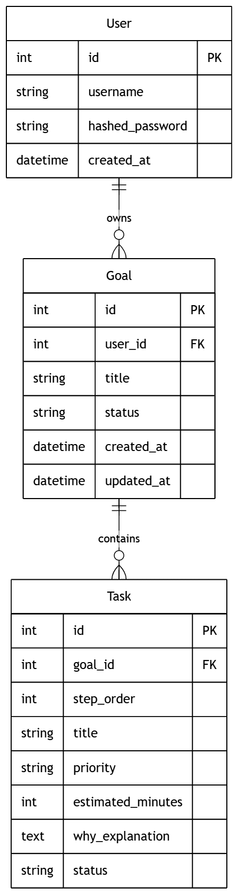

# 🎯 PlanAI —— AI 目标拆解规划助手

<p align="center">
  
  
  
</p>

**PlanAI** 是一个基于 FastAPI 的智能任务规划后端服务。用户只需输入一个目标（例如「一个月学会 Python 后端开发」），系统会调用大语言模型（DeepSeek / OpenAI）自动将其拆解为 **8~12 个可执行的具体任务**，并支持进度追踪、下一步推荐与计划重新生成。

---

## ✨ 功能特性

- 🤖 **AI 智能拆解**：输入一句话目标，自动生成结构化的任务清单（含步骤、优先级、预估耗时、执行理由）
- 🔐 **JWT 用户认证**：注册 / 登录，密码经 bcrypt 加密存储，Token 有效期 30 天
- 📊 **进度管理**：标记任务状态（未开始 / 进行中 / 已完成），全部完成时自动关闭目标
- 🧭 **下一步推荐**：一键获取当前目标下应该执行的下一个任务
- 🔄 **计划重生成**：对生成的计划不满意？带上反馈让 AI 重新规划
- 📄 **自动 API 文档**：内置 Swagger UI，接口即文档
- 🖥️ **内置前端页面**：附带一个静态 HTML 页面，开箱即用

---

## 🛠️ 技术栈

| 类别        | 技术                                      |
| ----------- | ----------------------------------------- |
| Web 框架    | [FastAPI](https://fastapi.tiangolo.com/)  |
| ASGI 服务器 | [Uvicorn](https://www.uvicorn.org/)       |
| ORM         | [SQLAlchemy](https://www.sqlalchemy.org/) |
| 数据库      | SQLite（默认） / PostgreSQL               |
| 认证        | JWT（python-jose） + bcrypt（passlib）    |
| AI 模型     | DeepSeek / OpenAI（通过 openai SDK 调用） |
| 数据校验    | Pydantic v2                               |

---

## 📦 快速开始

### 1. 克隆项目

```bash
git clone https://github.com/potateosssssssss/Plan_AI.git
cd Plan_AI
```

####  2、创建并激活虚拟环境

创建虚拟环境

`python -m venv .venv`

激活（Windows PowerShell）

`.\\.venv\Scripts\Activate.ps1`

激活（Mac / Linux）

`source .venv/bin/activate`

####  3、安装依赖

`pip install -r requirements.txt`

### 4. 配置环境变量

复制 `.env.example` 为 `.env`，并填入你的真实配置：

```
cp .env.example .env
```

`.env` 内容说明：

```
# 数据库连接地址（默认使用本地 SQLite）
DATABASE_URL=sqlite:///./planai.db

# JWT 加密密钥（请改成一串随机字符串）
SECRET_KEY=your-random-secret-key

# AI API 密钥（DeepSeek 或 OpenAI 的 Key）
OPENAI_API_KEY=your-api-key

# 使用的模型名称（DeepSeek 用 deepseek-chat）
OPENAI_MODEL=deepseek-chat
```

> 💡 **提示**：本项目默认接入 **DeepSeek**（见 `services/ai_planner.py` 中的 `base_url`）。
> 如需切换回 OpenAI 官方，请将 `base_url` 改为 `https://api.openai.com/v1`，并把 `OPENAI_MODEL` 设为 `gpt-3.5-turbo` 等。

### 5. 启动服务

```
uvicorn main:app --reload
```

启动成功后，你可以访问：

- 🖥️ 前端页面：http://127.0.0.1:8000/
- 📄 API 文档（Swagger）：http://127.0.0.1:8000/docs

------

## 📖 API 接口一览

### 认证模块 `/auth`

| 方法 | 路径             | 说明                 | 需要登录 |
| :--- | :--------------- | :------------------- | :------- |
| POST | `/auth/register` | 用户注册             | ❌        |
| POST | `/auth/login`    | 用户登录，获取 Token | ❌        |

### 目标模块 `/goals`

| 方法 | 路径                               | 说明                           | 需要登录 |
| :--- | :--------------------------------- | :----------------------------- | :------- |
| POST | `/goals/`                          | 创建目标（AI 自动拆解任务）    | ✅        |
| GET  | `/goals/`                          | 分页获取当前用户的目标列表     | ✅        |
| GET  | `/goals/{goal_id}`                 | 获取单个目标详情（含全部任务） | ✅        |
| GET  | `/goals/{goal_id}/next`            | 获取下一个待执行任务           | ✅        |
| PUT  | `/goals/{goal_id}/tasks/{task_id}` | 更新任务状态                   | ✅        |
| POST | `/goals/{goal_id}/regenerate`      | 根据反馈重新生成计划           | ✅        |

### 使用示例

**1. 注册用户**

```
curl -X POST "http://127.0.0.1:8000/auth/register" \
  -H "Content-Type: application/json" \
  -d '{"username": "test", "password": "123456"}'
```

**2. 登录获取 Token**

```
curl -X POST "http://127.0.0.1:8000/auth/login" \
  -d "username=test&password=123456"
```

**3. 创建目标（需带上 Token）**

```
curl -X POST "http://127.0.0.1:8000/goals/" \
  -H "Authorization: Bearer <你的Token>" \
  -H "Content-Type: application/json" \
  -d '{"title": "一个月学会 Python 后端开发"}'
```

------

## 🗂️ 项目结构

```text
plan_ai/
├── main.py                 # 应用入口：创建 app、注册路由、挂载前端、建表
├── config.py               # 配置中心：从 .env 加载环境变量
├── database.py             # 数据库引擎与会话（SessionLocal / get_db）
├── models.py               # ORM 数据模型：User / Goal / Task
├── schemas.py              # Pydantic 数据校验模型（请求 / 响应）
├── auth.py                 # JWT 鉴权：密码哈希、Token 生成与校验
├── routers/                # 路由层
│   ├── auth_router.py      # 注册 / 登录接口
│   └── goal_router.py      # 目标与任务相关接口
├── services/               # 业务服务层
│   └── ai_planner.py       # 核心：调用 AI 拆解目标为任务
├── static/                 # 前端静态页面
│   └── index.html
├── requirements.txt        # 项目依赖
├── .env.example            # 环境变量模板
└── planai.db               # SQLite 数据库文件（自动生成）
```

------

## 🗄️ 数据模型



- **User（用户）**：一个用户可拥有多个目标
- **Goal（目标）**：状态为 `active` / `completed`，一个目标包含多个任务
- **Task（任务）**：AI 拆解出的执行步骤，状态为 `not_started` / `in_progress` / `done`，同一目标下 `step_order` 唯一
